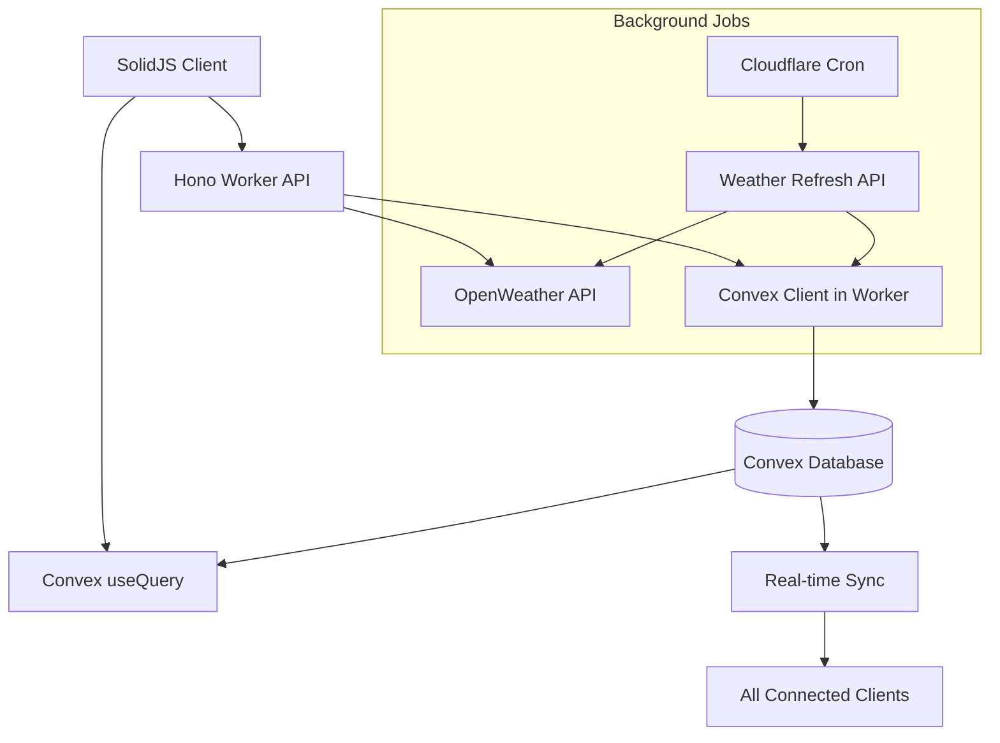

# Weather Dashboard Design Document

## Overview

The Weather Dashboard feature demonstrates a complete external API integration pattern using the existing SolidJS + Convex + Hono stack. This feature showcases how to:

1. **External API Integration**: Call OpenWeather API from Hono workers
2. **Server-side Convex Updates**: Update Convex database from worker endpoints
3. **Real-time Client Sync**: Automatically sync data across all connected clients
4. **Caching Strategy**: Implement intelligent data freshness and caching
5. **Error Handling**: Graceful degradation when external services fail

The architecture follows a hub-and-spoke pattern where the Hono worker acts as the central orchestrator between external APIs and the Convex database, while clients subscribe to real-time updates.

## Architecture

### Data Flow Architecture



### Component Architecture

```mermaid
graph LR
    subgraph "Client Layer"
        WeatherDashboard[Weather Dashboard Page]
        LocationForm[Add Location Form]
        WeatherCard[Weather Card Component]
        GeolocationHook[useGeolocation Hook]
    end
    
    subgraph "API Layer"
        WeatherAPI[/api/weather/*]
        LocationAPI[/api/weather/locations]
        RefreshAPI[/api/weather/refresh]
    end
    
    subgraph "Data Layer"
        ConvexSchema[Weather Schema]
        ConvexQueries[Weather Queries]
        ConvexMutations[Weather Mutations]
    end
    
    WeatherDashboard --> LocationForm
    WeatherDashboard --> WeatherCard
    WeatherDashboard --> GeolocationHook
    
    LocationForm --> LocationAPI
    WeatherCard --> ConvexQueries
    RefreshAPI --> ConvexMutations
```

## Components and Interfaces

### 1. Convex Schema Extensions

Add weather-related tables to the existing Convex schema:

```typescript
// convex/schema.ts additions
weatherLocations: defineTable({
  userId: v.string(),
  name: v.string(),           // "New York, NY"
  latitude: v.number(),
  longitude: v.number(),
  isCurrentLocation: v.boolean(), // true if detected via geolocation
  createdAt: v.number(),
}).index("by_userId", ["userId"]),

weatherData: defineTable({
  locationId: v.id("weatherLocations"),
  temperature: v.number(),
  feelsLike: v.number(),
  humidity: v.number(),
  windSpeed: v.number(),
  windDirection: v.number(),
  condition: v.string(),      // "Clear", "Cloudy", etc.
  description: v.string(),    // "clear sky"
  icon: v.string(),          // OpenWeather icon code
  lastUpdated: v.number(),   // timestamp
  source: v.string(),        // "openweather"
}).index("by_locationId", ["locationId"])
  .index("by_lastUpdated", ["lastUpdated"]),
```

### 2. Hono Worker API Endpoints

```typescript
// api/weather.ts
export interface WeatherEndpoints {
  // Add a new location for the authenticated user
  "POST /api/weather/locations": {
    body: { name: string; latitude?: number; longitude?: number; isCurrentLocation?: boolean }
    response: { success: boolean; locationId: string }
  }
  
  // Remove a location
  "DELETE /api/weather/locations/:locationId": {
    response: { success: boolean }
  }
  
  // Manually refresh weather for a location
  "POST /api/weather/refresh/:locationId": {
    response: { success: boolean; lastUpdated: number }
  }
  
  // Background refresh endpoint (called by cron)
  "POST /api/weather/refresh-all": {
    response: { refreshed: number; errors: number }
  }
}
```

### 3. Convex Functions

```typescript
// convex/weather.ts
export interface WeatherQueries {
  getUserLocations: (userId: string) => WeatherLocation[]
  getWeatherForLocation: (locationId: Id<"weatherLocations">) => WeatherData | null
  getUserWeatherDashboard: (userId: string) => WeatherDashboardData[]
}

export interface WeatherMutations {
  addLocation: (userId: string, location: LocationInput) => Id<"weatherLocations">
  removeLocation: (locationId: Id<"weatherLocations">, userId: string) => void
  updateWeatherData: (locationId: Id<"weatherLocations">, weatherData: WeatherInput) => void
}
```

### 4. SolidJS Components

```typescript
// src/routes/weather.tsx
interface WeatherDashboardProps {
  // Uses existing auth context for userId
}

// src/components/weather/WeatherCard.tsx
interface WeatherCardProps {
  location: WeatherLocation
  weather: WeatherData | null
  onDelete: (locationId: string) => void
  onRefresh: (locationId: string) => void
}

// src/components/weather/AddLocationForm.tsx
interface AddLocationFormProps {
  onLocationAdded: (location: WeatherLocation) => void
}
```

## Data Models

### WeatherLocation Model
```typescript
interface WeatherLocation {
  _id: Id<"weatherLocations">
  userId: string
  name: string              // "San Francisco, CA"
  latitude: number          // 37.7749
  longitude: number         // -122.4194
  isCurrentLocation: boolean // true if from geolocation
  createdAt: number         // timestamp
}
```

### WeatherData Model
```typescript
interface WeatherData {
  _id: Id<"weatherData">
  locationId: Id<"weatherLocations">
  temperature: number       // in Celsius
  feelsLike: number        // in Celsius
  humidity: number         // percentage
  windSpeed: number        // m/s
  windDirection: number    // degrees
  condition: string        // "Clear", "Clouds", "Rain"
  description: string      // "clear sky", "light rain"
  icon: string            // "01d", "02n" (OpenWeather codes)
  lastUpdated: number     // timestamp
  source: string          // "openweather"
}
```

### OpenWeather API Integration
```typescript
interface OpenWeatherResponse {
  main: {
    temp: number
    feels_like: number
    humidity: number
  }
  wind: {
    speed: number
    deg: number
  }
  weather: Array<{
    main: string
    description: string
    icon: string
  }>
  dt: number // timestamp
}
```

## Error Handling

### 1. External API Failures
- **Rate Limiting**: Implement exponential backoff for OpenWeather API calls
- **Service Unavailable**: Serve cached data when API is down
- **Invalid Locations**: Validate locations before saving to database
- **Network Timeouts**: Set reasonable timeouts and retry logic

### 2. Client-Side Error States
- **Loading States**: Show skeleton loaders while fetching data
- **Error Boundaries**: Catch and display API errors gracefully
- **Retry Mechanisms**: Allow users to manually retry failed operations
- **Offline Support**: Show last known data when offline

### 3. Data Consistency
- **Stale Data Detection**: Mark data older than 30 minutes as stale
- **Conflict Resolution**: Handle concurrent updates to the same location
- **Cleanup Jobs**: Remove orphaned weather data for deleted locations

## Testing Strategy

### 1. Unit Tests
- **API Endpoint Tests**: Test each Hono worker endpoint
- **Convex Function Tests**: Test queries and mutations
- **Component Tests**: Test SolidJS components in isolation
- **Utility Function Tests**: Test weather data transformation functions

### 2. Integration Tests
- **End-to-End Flow**: Test complete user journey from adding location to seeing weather
- **Real-time Updates**: Test that updates propagate to all connected clients
- **External API Mocking**: Mock OpenWeather API responses for consistent testing
- **Error Scenario Testing**: Test behavior when external APIs fail

### 3. Performance Tests
- **API Response Times**: Ensure weather endpoints respond quickly
- **Database Query Performance**: Test Convex queries with multiple locations
- **Real-time Update Performance**: Test update propagation with many connected clients
- **Caching Effectiveness**: Verify that caching reduces API calls

## Implementation Phases

### Phase 1: Core Infrastructure
1. Extend Convex schema with weather tables
2. Create basic Hono weather API endpoints
3. Implement OpenWeather API integration
4. Set up Convex client in worker for database updates

### Phase 2: Basic UI
1. Create weather dashboard page
2. Implement add location form
3. Create weather card component
4. Add basic error handling and loading states

### Phase 3: Real-time Features
1. Implement Convex subscriptions for real-time updates
2. Add automatic background refresh
3. Implement geolocation detection
4. Add smooth UI transitions for data updates

### Phase 4: Advanced Features
1. Implement intelligent caching strategy
2. Add comprehensive error handling
3. Implement rate limiting and retry logic
4. Add cleanup jobs for stale data

## Security Considerations

### 1. API Key Protection
- Store OpenWeather API key as Cloudflare Worker secret
- Never expose API keys to client-side code
- Implement usage monitoring to prevent abuse

### 2. User Data Protection
- Ensure users can only access their own weather locations
- Validate user permissions on all API endpoints
- Sanitize location names to prevent XSS

### 3. Rate Limiting
- Implement per-user rate limiting for location additions
- Prevent abuse of weather refresh endpoints
- Monitor API usage to stay within OpenWeather limits

## Monitoring and Observability

### 1. Metrics to Track
- OpenWeather API call frequency and success rate
- Weather data freshness across all locations
- User engagement with weather dashboard
- Error rates for different failure scenarios

### 2. Logging Strategy
- Log all external API calls with response times
- Log user actions (add/remove locations)
- Log errors with sufficient context for debugging
- Monitor Convex database performance

This design provides a comprehensive example of external API integration while maintaining the real-time, reactive nature of the existing SolidJS + Convex stack.